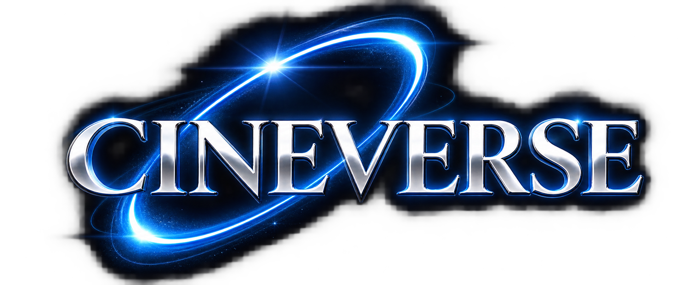
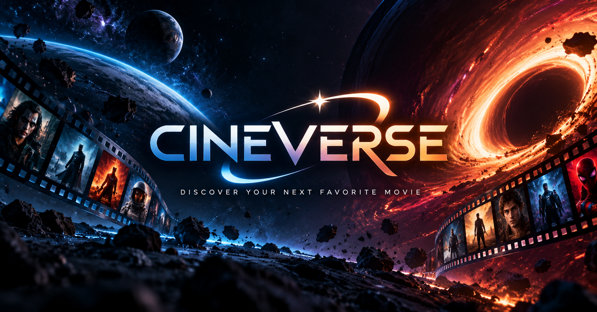

  

<h1 align="center">CINEVERSE</h1>

  <strong>A universe of stories. A new world in every movie.</strong>
   
  Discover films, explore genres, uncover details, and let the universe choose your next watch.

  
  

  
  
  
  
  
  

  

✦ About the project
CINEVERSE is a cinematic movie-discovery website built around one idea: browsing movies should feel like exploring a universe.

Instead of a plain catalog, CINEVERSE uses a space-inspired interface, glowing planetary visuals, animated transitions, and interactive experiences to make discovering a movie part of the entertainment.

The project is built with HTML, SCSS, and vanilla JavaScript. It uses movie data delivered as JSON, with movie artwork loaded from TMDB's image CDN.

  <a href="https://amro-fathi.github.io/CINEVERSE/"><strong>✧ Explore the live experience ✧</strong></a>

🚀 Explore CINEVERSE
1. Galaxy gateway
The entry page is designed as a space-navigation experience. Each glowing star represents a destination in the website. Selecting a destination triggers its visual transition before the gateway routes to the requested page.
- Animated star field and layered space gradients.
- Individual color palettes and labels for each destination.
- URL-based routing through the gateway.
- Movie destinations can carry a movie ID through the route.
2. Home — the movie universe
The Home page is the starting point for discovering something to watch.
- Today's Destination: a randomly selected movie presented as a featured discovery.
- Random World: jump to a randomly selected movie.
- Top Rated: discover a random selection from the top-rated collection.
- Latest Releases: browse the newest entries in the available movie collection.
- Spacecraft-inspired navigation and cinematic page sections.
3. Explore — discover your next world
Explore turns movie genres into an interactive discovery experience.
- Genre planets: select a genre to load its movie collection.
- Top Rated collection: browse movies from the top-rated dataset.
- Movie roulette: spin an interactive wheel to receive a random movie.
- Cinematic reveal: the roulette uses animated portal, claw, and movie-reveal effects.
4. Movie details — enter the story
Every movie has a dedicated details page, populated dynamically from the selected movie's data.

Depending on the available data, the page presents:
- Movie poster, logo, tagline, and overview.
- Release year, runtime, rating, vote count, and popularity.
- Genres, release date, and an IMDb link when available.
- Trailer access.
- Image gallery with a 3D coverflow-style slider.
- Community reviews.
- Cinematic reveal effects, animated meteorites, and sound effects.
5. Login & registration
A dedicated account interface with a shared Login / Register layout.
- Switch between sign-in and registration states.
- Show or hide password input.
- Space-themed visuals consistent with the rest of CINEVERSE.
Current implementation note: Login and registration are front-end interfaces only. There is no authentication server, account creation, or session management connected yet. Do not use real passwords on the demo.

🧭 Pages & routes
The root index.html acts as the navigation gateway. The where query parameter selects the destination, and the optional id parameter carries the selected movie into the details page.
Destination	Gateway URL	Page
Home	index.html?where=home	pages/home.html
Explore	index.html?where=explore	pages/explore.html
Login	index.html?where=login	pages/login.html
Movie details	index.html?id=MOVIE_ID&where=movie	pages/movie.html?id=MOVIE_ID

The project also uses shared JavaScript navigation helpers in js/api/fetch.js, including goToHome(), goToPage(), and goToMovie().
🛠️ Built with
Technology	Role
HTML5	Page structure and content
SCSS / Sass	Modular styling, variables, mixins, and responsive layouts
Vanilla JavaScript	Data loading, navigation, rendering, and interactions
Bootstrap	Grid system and utility classes
Swiper	Movie image galleries and sliders
Animate.css	UI animation utilities
Font Awesome	Interface icons
TMDB image CDN	Movie poster and backdrop images

No frontend framework is required. CINEVERSE is implemented with regular JavaScript rather than React, Vue, or Angular.
🎞️ Movie data & images
CINEVERSE currently reads prebuilt JSON data from a separate static data endpoint:

Base data URL:
https://amro-fathi.github.io/api/

The data layer in js/api/fetch.js exposes three main helpers:
Helper	Resource	Purpose
getAllMovies()	movies.json	Loads the main movie collection
getData(category)	categories/CATEGORY.json	Loads a category or genre collection
getReviews(id)	reviews.json	Loads reviews for a movie ID

Movie artwork is requested from TMDB's image CDN using the stored image paths:
https://image.tmdb.org/t/p/original/IMAGE_PATH
The current frontend does not call the TMDB API directly or require a TMDB API key. It consumes the hosted JSON data and uses TMDB's image CDN for artwork.

CINEVERSE is an independent, unofficial project and is not endorsed or certified by TMDB. Movie metadata and artwork remain the property of their respective owners.
💻 Run it locally
CINEVERSE is a static website, so no backend or package installation is needed to view the already-compiled project. Because movie data is fetched from remote JSON files, run it through a local web server rather than opening the HTML files directly with file://.
1. Clone the repository
git clone https://github.com/Amro-Fathi/CINEVERSE.git
cd CINEVERSE
2. Start a local server
Option A — Python
python -m http.server 5500
Option B — VS Code

Open the project folder in Visual Studio Code and use the Live Server extension to launch index.html.
3. Open CINEVERSE
Visit:
http://localhost:5500/
You will need an internet connection for the hosted movie data and remote movie artwork to load.
🎨 Working with the SCSS
The project keeps its Sass source in the sass/ directory and the compiled stylesheet in css/index.css.

The main Sass entry point is:
sass/index.scss
It loads the page and component entry points. Shared variables and mixins live in sass/abstracts/, while page and interface styles are organized under sass/components/ and sass/pages/.

If you have Sass installed, compile and watch the source with:
npm install --global sass
sass --watch sass/index.scss:css/index.css
The compiled CSS is already included in the repository, so Sass is only needed when you want to modify the styling source.
📁 Project structure

CINEVERSE/

├── audio/                 # Explosion and meteorite sound effects

├── css/                   # Compiled styles and local vendor stylesheets

├── images/                # Logos, backgrounds, planets, posters, and UI artwork

├── index.html             # Galaxy navigation gateway

├── js/

│   ├── api/

│   │   └── fetch.js       # Movie data requests and navigation helpers

│   ├── components/

│   │   ├── navbar.js      # Shared navigation interactions

│   │   ├── shuffle.js     # Text reveal and cinematic effects

│   │   ├── spaceship.js   # Scroll-linked spaceship navigation

│   │   └── spinner.js     # Interactive movie roulette

│   ├── pages/

│   │   ├── explore.js     # Genre and Explore page behavior

│   │   ├── home.js        # Home page movie sections

│   │   ├── loading.js     # Gateway routing and transitions

│   │   ├── login.js       # Login/Register interface behavior

│   │   └── movie.js       # Dynamic movie details and gallery

│   └── plugins/           # Local JavaScript plugins

├── pages/
│   ├── explore.html       # Movie discovery page

│   ├── home.html          # Main movie homepage

│   ├── login.html         # Login and registration page

│   └── movie.html         # Movie details page

├── sass/

│   ├── abstracts/         # Variables and reusable mixins

│   ├── components/        # Component and page-section styles

│   ├── pages/             # Global page styles

│   └── index.scss         # Main Sass entry point

└── webfonts/              # Locally hosted Font Awesome fonts

⚙️ Notes
- Static hosting: the project is designed to run on GitHub Pages or another static web host.
- Remote data: movie lists, genre/category data, reviews, and TMDB artwork need an active internet connection.
- Direct page access: the individual HTML pages live in pages/; internal navigation uses the root gateway so its transition can play.
- Authentication: the Login/Register screens are currently UI-only.
- User features: account-backed favorites, watch history, and persistent watchlists are not connected to a backend yet.
👨‍🚀 Author
Amr Fathi Mohammed
- GitHub: @Amro-Fathi
- Project: CINEVERSE
- Live website: amro-fathi.github.io/CINEVERSE

  <strong>Made with curiosity, code, and a love for cinema. ✦</strong>
   
  Explore. Discover. Belong.

